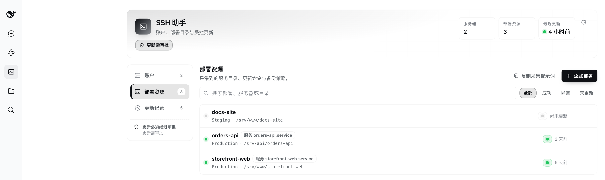
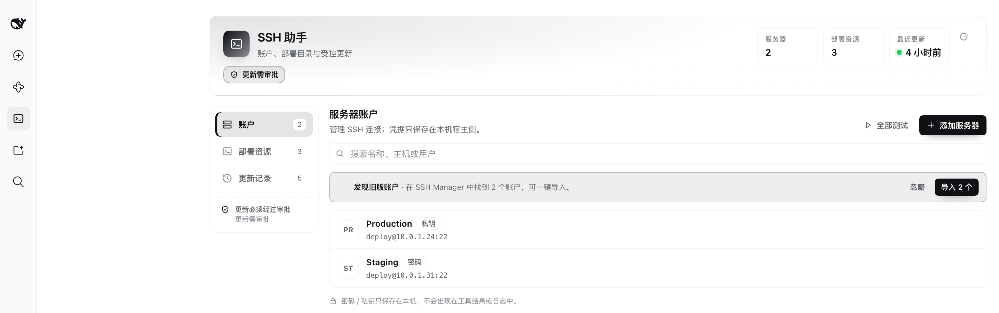
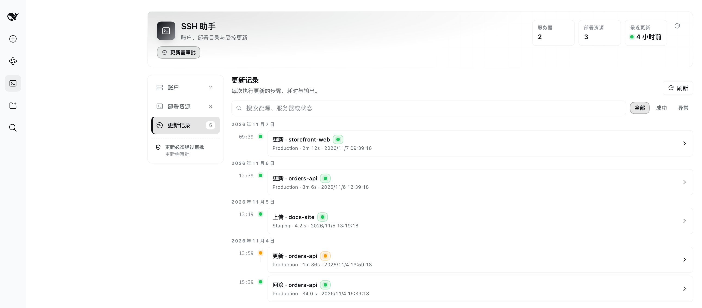
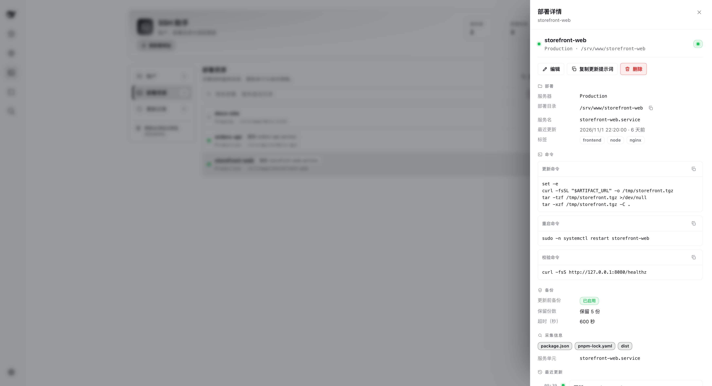

# SSH Helper for DeepSeek Harness

[](https://www.npmjs.com/package/@hunan36/dsh-ssh-helper)
[](https://www.npmjs.com/package/@hunan36/dsh-ssh-helper)
[](LICENSE)
[]()
[](https://github.com/hunan36/dsh-ssh-helper)

SSH accounts, a deployment-directory catalogue, and **approval-gated** remote updates and rollbacks for DeepSeek Harness.

`@hunan36/dsh-ssh-helper` gives the agent a small, boring, auditable set of SSH operations: list accounts, look around a server read-only, and — only after you click approve — push a file, run an update, or restore a backup. There is no generic remote-exec tool in the package, and no "update now" button in the panel. Every write crosses DSH's native approval prompt, every time.



*The Deployment resources view: every resource carries its server, app directory, update command, restart/verify command and backup policy.*

<p align="center">
  
  
</p>

<p align="center">
  
</p>

<p align="center">
  <em>Left to right, top to bottom: accounts, the update-history timeline, and a resource detail sheet — the panel only displays and copies; it never executes a remote write.</em>
</p>

---

## Why this plugin

An agent that can SSH into production is useful right up until it runs the wrong command unattended. Most SSH plugins solve that either by refusing to write at all, or by writing freely. This one takes the middle path: the agent can discover and catalogue deployment directories on its own, can prepare a full update plan on its own, but the moment a byte is written to a remote host, DSH stops and asks you — showing the exact target, the exact commands and the exact backup path in the prompt.

The approval is not a convention the model is politely asked to follow. It is a `tools/pre-execute` handler in the host process that the tool implementation cannot bypass, because the tool bodies never receive an "approved" flag at all.

## Features

| Area | What you get |
| --- | --- |
| Account manager | Add, edit, delete and test SSH accounts. Password auth, or private key with an optional passphrase. |
| Connection test | Per-account and "test all", from the panel or via `ssh_helper_accounts` with `action="test"` (runs `uname -srm` plus `id -un`). |
| Legacy import | One-click import of accounts from an existing `@local/dsh-ssh-manager` install, de-duplicated by `host:port:username`. |
| Read-only discovery | `ssh_helper_discover` scans common roots (`/opt`, `/srv`, `/var/www`, `/data`, `/app`, `/home`) for project markers, then inspects one directory: top-level entries, markers, git state, listening services. File contents are never read. |
| Resource catalogue | Each deployment resource stores server, app directory, update/restart/verify commands, backup policy, timeout and the facts discovered about it. No credentials. |
| Update planning | `ssh_helper_update_plan` runs a read-only preflight (directory exists, writable, free space for the backup, markers, git state) and returns a plan id, warnings and blockers. Nothing is modified. |
| Gated apply | `ssh_helper_update_apply` backs up, runs update → restart → verify, prunes old backups and records history. Always asks first. |
| Gated rollback | `ssh_helper_update_rollback` moves the current directory aside, extracts the recorded backup, then optionally restarts and verifies. Always asks first. |
| Gated upload | `ssh_helper_upload` pushes one local file over SFTP, then verifies byte size and SHA-256 **on the server**. Partial verification is reported as `partial`, not `success`. |
| Update history | Every apply, rollback and upload records its steps, exit codes, durations and output tails (last 200 entries). |
| System prompt | A `## SSH Helper` section is rebuilt on every turn with the current accounts and resources, and states that the three write tools always require approval. |
| Bilingual panel | Left-sidebar panel with English and Chinese strings; Accounts / Deployments / Activity views, search, status filters and copy-to-session prompt buttons. |

## Install

**Requirements**

- DSH with the `tools`, `systemPrompt`, `webServer` and `connection` services. Verified against DSH `0.2.2-rc.1`; any build that provides those four host services should work.
- Node `^22.19.0 || >=24.0.0`. The only runtime dependency is `ssh2`, which works without a compiler: its native `cpu-features` helper is optional and installation succeeds when it cannot be built.

### From npm (recommended)

Install the package into your DSH profile and add it to the profile's bundle list:

```bash
# inside the DSH profile directory
pnpm add @hunan36/dsh-ssh-helper
```

Then add `@hunan36/dsh-ssh-helper` to the bundle list of that profile. The package ships its own bundle patch (`cordis.patch.yml`), which mounts the host half as the loader row `ssh-helper`:

```yaml
- insert:
    - id: ssh-helper
      name: dsh-ssh-helper
      config: {}
```

### From the plugin manager (GUI)

Sidebar → Plugins → add a plugin, and give it either the npm spec `@hunan36/dsh-ssh-helper` or, for a local checkout, the absolute path of this directory.

### From source

```bash
git clone https://github.com/hunan36/dsh-ssh-helper.git
cd dsh-ssh-helper
npm install --ignore-scripts
npm test
```

Point the plugin manager at the checkout directory.

### After installing

- Host-side changes (tools, API, prompt section, approval gate) need a **DSH restart**.
- Client-side changes need a **page refresh**.
- An **SSH Helper** entry appears in the left sidebar. It is not under DSH Settings.

## Quick start

Five minutes from zero to a gated update.

1. **Add a server.** Sidebar → SSH Helper → Accounts → Add server. Enter host, port, username, and either a password or a private key (plus passphrase). Save, then press **Test** — a success shows the remote `uname` and user.

2. **Ask the agent to look around.** Start a session and say:

   > Scan 10.0.1.24 for deployment directories, find web-api, and save its directory, git state and service unit as a deployment resource.

   The agent calls `ssh_helper_discover` (`action="scan"`), then `action="inspect"` on the candidate, then `ssh_helper_resources` (`action="save"`). Both discovery actions are read-only.

3. **Ask for a plan.**

   > Give me an update plan for web-api. Don't run anything yet.

   The agent calls `ssh_helper_update_plan`. You get the plan id, the resolved app directory, the backup archive path, the update/restart/verify commands, the preflight facts, and any warnings or blockers. A plan with blockers cannot be applied.

4. **Apply it.**

   > Go ahead and apply that plan.

   The agent calls `ssh_helper_update_apply` with the plan id. **DSH shows an approval prompt** listing the resource, server, directory, backup path and the exact commands. Nothing happens until you approve.

5. **Watch and verify.** The run appears in the Activity view: one row per step (preflight, backup, update, restart, verify, prune) with exit code, duration and output tails. If it went wrong, say:

   > Roll back web-api to the last backup.

   which is again an approval-gated `ssh_helper_update_rollback`.

### Optional: upload a build artifact first

> Upload /Users/me/build/web-dist.tgz to /tmp/web-dist.tgz on 6.25, then update web-fe.

The agent calls `ssh_helper_upload`, you approve the transfer, the file goes over SFTP, and the plugin verifies size and SHA-256 on the server before reporting success. The remote file can then be consumed by the update command, for example:

```bash
test -f /tmp/web-dist.tgz && tar -xzf /tmp/web-dist.tgz -C .
```

## The approval model

This is the part worth reading before you point the plugin at a real server.

### One gate, three tools

The plugin registers a single `tools/pre-execute` handler. It inspects the tool name and returns one of two outcomes:

- `{ kind: 'ask', reason, displayReason: { en, zh } }` for a **resolvable** write request;
- `next()` — fall through — for everything else.

DSH then requests approval and **only dispatches the tool on an `allowed-once` decision**. A denied, cancelled or unavailable approval channel dispatches nothing. The tool body has no idea whether an approval happened; there is no `confirm`, `force` or `skip_approval` parameter anywhere in the package.

### A remote write happens only when all of these are true

1. The tool is exactly one of `ssh_helper_upload`, `ssh_helper_update_apply` or `ssh_helper_update_rollback`.
2. The arguments resolve into a concrete target:
   - **apply** — the plan id exists, has not expired, does not carry blockers, and belongs to the calling agent;
   - **rollback** — a backup archive from a previous `apply` entry resolves for that resource (optionally a specific `history_id`);
   - **upload** — the account resolves, the local path is an existing non-empty regular file under 2 GiB, and the remote path passes the path validator.
3. You answer the prompt with an allow-once decision for that exact call.
4. For apply and rollback, no other apply/rollback is already running against that server.

### The gate fails closed

If the gate cannot be registered at all — a harness that renames `tools/pre-execute`, a plugin-ordering failure, any throw — the host logs a warning and **registers only the read-only tools**. `apply`, `rollback` and `upload` are never mounted. This matters because DSH's `tools/pre-execute` waterfall defaults to *allow*: a write tool without a gate is a write with no approval, so a missing gate must remove the tool rather than leave it unguarded. You get four tools instead of seven, and the agent is told the write tools are unavailable.

### The approved target is pinned, not re-resolved

For rollback, the archive that the prompt names is the archive that gets extracted. The gate pins the resolved backup entry; the tool body consumes that pin instead of resolving the backup a second time, and the pin is dropped if the resource's app directory, server or history entry changed in the meantime. Without this, an `apply` landing while the prompt is open could silently swap which tree you restore. Apply already had the equivalent guarantee through its `plan_id`.

### Commands are fenced in the prompt

A resource's update command is a shell script and may legitimately span several lines, so it is not flattened. It is instead wrapped in an explicit `----- command (verbatim) -----` fence, and every other interpolated field (resource name, server, directory, backup path, restart/verify command) is forced onto a single line with control characters and bidirectional overrides removed. A resource name cannot therefore forge a `Backup: disabled.` line in the prompt you read, and a path cannot render reversed.

### When the gate falls through

If a request does not resolve, **no approval prompt is shown and the tool body returns a guidance message instead**. That is deliberate: a prompt that cannot correspond to a real action is just noise, and an invalid request must never look approved. Cases that fall through:

- apply with a missing, unknown, expired or foreign-agent plan id;
- apply with a plan that has blockers (missing directory, not writable, empty update command, backup dir inside the app dir, not enough free space);
- rollback with no recorded backup;
- upload with a missing account, non-absolute or unreadable local path, empty file, oversized file, or a resource belonging to a different server.

### Approval presets

Approval is enforced by DSH, so the session's approval policy applies. A preset whose approval mode is `never` declines the prompt automatically — the update simply does not run, and the agent gets a refusal. If you want gated updates to work, use a preset that can ask.

### What the prompt contains

| Tool | Shown in the prompt |
| --- | --- |
| apply | Plan id, resource name, server, app directory, backup archive path (or `disabled`), update command (truncated at 300 characters), restart and verify commands when set, plan warnings. |
| rollback | Resource name, server, app directory, backup archive to restore, a note that the current directory is moved aside first, the restore command, restart and verify commands when set, path warnings. |
| upload | File name, human-readable size, target server, remote path, local path, the associated deployment resource when given, a note that size and SHA-256 are verified after transfer, path warnings. |

### What the panel can and cannot do

The panel is a read/diagnostics console. It talks to the plugin's own HTTP API (`accounts/*`, `resources/*`, `history/*`) and has **no update or rollback button**. The only way to change a remote host is an approved agent tool call.

The API itself is `POST /ssh-helper/api/<method>` with a JSON envelope (`{ ok: true, data }` or `{ ok: false, error: { code, message } }`). Every request is fenced by DSH's `connection.requestRejection`, request bodies are capped at 1 MiB, and no method returns a password, private key or passphrase.

## Tool reference

Seven tools, all prefixed `ssh_helper_`. Accounts and resources are addressed by id or name (exact name, case-insensitive, then a unique name prefix).

| Tool | `action` / key inputs | Writes remotely | Approval |
| --- | --- | --- | --- |
| `ssh_helper_accounts` | `action: list \| test`; `account`; `timeout_seconds` (1–120, default 20) | no | not needed |
| `ssh_helper_discover` | `action: scan \| inspect`; `server`; `roots`; `path`; `max_depth` (1–4, default 3); `limit` (1–200, default 80); `timeout_seconds` (1–600, default 60) | no | not needed |
| `ssh_helper_resources` | `action: list \| get \| history \| save \| delete`; `resource`; `server`; `name`; `app_dir`; `update_command`; `restart_command`; `verify_command`; `backup_enabled`; `backup_dir`; `backup_keep` (1–50, default 5); `timeout_seconds` (30–3600, default 600); `note` (≤500); `tags`; `discovered` | no (metadata only) | not needed |
| `ssh_helper_update_plan` | `resource`; `timeout_seconds` (1–600, default 60) | no (read-only preflight) | not needed |
| `ssh_helper_update_apply` | `plan_id` | yes | **every call** |
| `ssh_helper_update_rollback` | `resource`; `history_id` (optional) | yes | **every call** |
| `ssh_helper_upload` | `server`; `local_path`; `remote_path`; `resource` (optional); `timeout_seconds` (5–3600, default 300) | yes | **every call** |

There is deliberately **no generic remote-exec tool**. Ad-hoc commands stay in whatever other SSH plugin you already use; the system prompt tells the agent that changes to a catalogued deployment directory must go through `ssh_helper_update_*`, never through a generic exec.

Plans are single-use and short-lived: a plan expires after 15 minutes, is bound to the agent that created it, and is dropped after its apply attempt, so the same `plan_id` cannot be replayed.

## Security model

- **Credentials stay host-side.** `accounts.json` is read and written only by the host process. Every public projection (tool results, HTTP API responses, system prompt, approval reasons, update history) drops the password, private key and passphrase; the API has no endpoint that returns them. The browser keeps secrets only in the open dialog form, and `localStorage` holds exactly one unrelated flag ("legacy import dismissed").
- **File permissions.** Data files are written to a `.tmp` sibling and renamed into place, with mode `0600` applied to both the temporary file and the final file (best effort — a filesystem that rejects `chmod` cannot be corrected by the plugin). A file that fails to parse is quarantined as `<name>.corrupt-<timestamp>` and the plugin starts from an empty store instead of crashing.
- **Path validation.** Every remote directory is checked: absolute path, ≤1024 characters, no control characters, no `..` segment, not exactly one of the blocked system directories (`/`, `/bin`, `/boot`, `/dev`, `/etc`, `/lib`, `/lib64`, `/proc`, `/run`, `/sbin`, `/sys`, `/usr`, `/var`, `/var/lib`, `/var/log`, `/var/run`, `/home`), and not anywhere below `/bin`, `/boot`, `/dev`, `/etc`, `/lib`, `/lib64`, `/proc`, `/run`, `/sbin`, `/sys` or `/usr`. The backup directory is validated by the same rules, and a backup directory inside the app directory is rejected.
- **Everything is quoted.** Every user-controlled value that reaches a remote shell goes through POSIX single-quote quoting (`'…'`, with embedded quotes escaped as `'\''`).
- **Backup before change.** The default backup is a `tar.gz` of the app directory written to `<parent of appDir>/.ssh-helper-backups/<resource>/<resource>-<UTC stamp>.tar.gz`. If free space on the target filesystem is below `1.2 × directory size + 10 MiB`, the plan carries a blocker and cannot be applied.
- **No automatic rollback.** If the update command, restart or verify fails, the run stops, keeps the backup and records the failure. Nothing is rolled back behind your back; you decide.
- **Rollback is reversible.** The current directory is moved to `<appDir>.ssh-helper-before-rollback-<UTC stamp>` before the archive is extracted, so the pre-rollback state survives.
- **Host keys are accepted as presented (v1).** The client sets `hostVerifier: () => true`. There is no `known_hosts` pinning and no TOFU prompt yet; treat the network path to your servers accordingly, and prefer a VPN or bastion.
- **Shell is not interactive.** Update, restart and verify commands run as `cd <appDir> && bash -lc <command>` over a non-PTY session, with the SSH user's privileges. Interactive `sudo` prompts cannot be answered, so use `NOPASSWD` sudoers entries or `sudo -n`.
- **Commands are visible by design.** The update, restart and verify commands appear verbatim in the approval prompt and in the history file. Never inline tokens, passwords or keys into a command; reference a file or an environment variable instead. Captured **output** is a different case: stdout and stderr tails are scrubbed before they are persisted, masking `password` / `passwd` / `passphrase` / `token` / `secret` / `api_key` assignments and PEM private-key blocks. That scrub is defence in depth, not a licence to echo secrets — a secret on its own line, with no `name=value` shape, is not caught.
- **Local paths are not echoed back.** A failed local-file check returns a path-free message, so the agent cannot use upload errors to probe whether a file exists on your machine or how large it is. The path still appears in the approval prompt, where you are the reader.
- **Timeouts are local.** When an SSH operation times out, the plugin closes the local connection — the remote process may keep running. Size `timeout_seconds` for long builds and migrations.
- **Remote output is bounded.** Stdout is capped at 512 KiB and stderr at 256 KiB per command; history keeps the last 8192 characters of each stream.

## Data and files

Resolution order, first match wins:

1. `DSH_SSH_HELPER_DIR` — explicit override (tests, throwaway profiles);
2. `$DSH_HOME/ssh-helper`;
3. `~/.dsh/ssh-helper`.

| File | Contents | Contains secrets |
| --- | --- | --- |
| `accounts.json` | SSH accounts: name, host, port, username, auth type, credential, note, timestamps | **yes** (mode `0600`) |
| `resources.json` | Deployment resources: server reference, app directory, commands, backup policy, timeout, tags, discovered facts | no (mode `0600`) |
| `history.json` | Up to 200 apply / rollback / upload entries with per-step commands, exit codes, durations and output tails | no (mode `0600`) |

Legacy import reads, in order, `$DSH_HOME/ssh-manager/servers.json` and `$DSH_PROFILE_DIR/data/ssh-manager/servers.json`. Import is manual — the plugin never imports on its own — and entries that fail validation or duplicate an existing `host:port:username` are skipped.

## Configuration and limits

### Environment variables

| Variable | Purpose |
| --- | --- |
| `DSH_SSH_HELPER_DIR` | Override the plugin data directory. |
| `DSH_HOME` | Base directory for the default data path and the primary legacy import source. |
| `DSH_PROFILE_DIR` | Secondary legacy import source (`data/ssh-manager/servers.json`). |

### Remote host requirements

| Requirement | Why | Required |
| --- | --- | --- |
| POSIX `sh`, `tar`, `find`, `du`, `df`, `stat`, `id`, `uname` | Backup, preflight, discovery, upload verification | yes |
| SFTP subsystem | File upload | only for `ssh_helper_upload` |
| `bash` | Update, restart and verify commands run under `bash -lc` | only for apply/rollback |
| `sha256sum` or `shasum -a 256` | Upload digest verification | only for upload |
| `git` | Reports remote/branch/commit/dirty during discovery and preflight | optional |
| `systemctl`, `docker`, `ss`/`netstat` | Raw service and port hints during discovery | optional |

### Known limitations

- **Single-file uploads only.** `ssh_helper_upload` pushes one regular file over SFTP. No directory sync, no resume, no remote deletion, 2 GiB ceiling.
- **No host-key pinning.** v1 accepts whatever key the server presents (see above). `known_hosts` verification is the most important missing control.
- **No cross-process locking.** Writes are serialized inside one host process and a per-server flag prevents two concurrent apply/rollback runs, but two DSH processes sharing the same data directory are not coordinated beyond atomic file replacement.
- **No in-panel update button, by design.** Applying and rolling back are agent-tool-only operations so that every write passes the approval gate.
- **No automatic account import.** Legacy import is a button, not a background migration.
- **Discovery never reads file contents.** It records directory structure, marker file names, git metadata and service names — never `.env`, config bodies or logs.
- **Backups are whole-directory archives.** A large `node_modules` or artifact directory inflates the archive and the free-space requirement.
- **Plans expire after 15 minutes** and at most 50 are cached; a stale plan id must be regenerated.
- **Output is truncated.** Commands producing more than 512 KiB of stdout lose the tail for that step; raise limits by making the command quieter.
- **Pre-1.0.** Tool names, data file shapes and panel layout may still change between minor versions.

## Relationship to `@local/dsh-ssh-manager`

The two plugins coexist. `dsh-ssh-manager` keeps its `ssh_servers` and `ssh_exec` tools and its own Settings page; this plugin uses an independent `ssh_helper_*` tool namespace and its own sidebar panel. The overlap is limited to a one-way, on-demand import of its `servers.json` account list — nothing is imported automatically, and nothing is shared afterwards.

## Development

```bash
npm test        # syntax check + node:test unit and in-process SSH end-to-end tests
npm run smoke   # host-side smoke test, no network, no real data directory
npm run check   # syntax check only
```

The test suite runs a real `ssh2` server on loopback for the end-to-end cases (probe, scan, inspect, plan, apply, rollback, and a deliberately failing update that must keep its backup without auto-rollback).

```text
dsh-ssh-helper/
├── index.js            # host entry: stores, services, gate, tools, prompt, API in one ctx.effect
├── client.js           # sidebar panel (single file, React only, no build step)
├── cordis.patch.yml    # bundle row: ssh-helper
├── host/
│   ├── accounts.js     # account store, 0600, legacy import, redaction
│   ├── resources.js    # deployment resource catalogue
│   ├── history.js      # capped update history
│   ├── atomic.js       # tmp+rename JSON storage with corrupt-file quarantine
│   ├── ssh.js          # ssh2 exec / probe / SFTP upload, bounded capture
│   ├── shell.js        # path validation, POSIX quoting, backup layout
│   ├── discover.js     # read-only scan and inspect command builders
│   ├── update.js       # plan / apply / rollback service
│   ├── upload.js       # upload resolve / execute with server-side verification
│   ├── gate.js         # the tools/pre-execute approval handler
│   ├── tools.js        # the seven agent tools and their renderers
│   ├── prompt.js       # ## SSH Helper system-prompt section
│   └── api.js          # /ssh-helper/api prefix route
├── locale/             # plugin manager title and description (en, zh)
├── test/               # unit tests + in-process ssh2 server E2E
└── scripts/            # syntax check, smoke test
```

## Contributing

Issues and pull requests are welcome at [github.com/hunan36/dsh-ssh-helper](https://github.com/hunan36/dsh-ssh-helper). Please run `npm test` before opening a PR, and keep the property that no tool can write to a remote host without passing through `host/gate.js` — pull requests that add a `confirm`, `force` or `skip_approval` escape hatch will be declined.

## License

[MIT](LICENSE)
