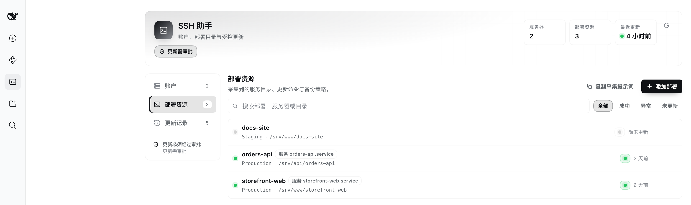
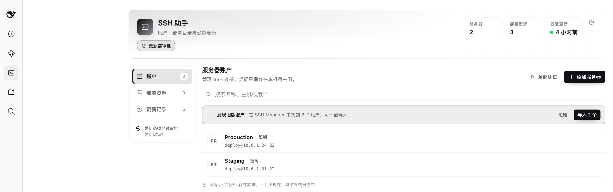
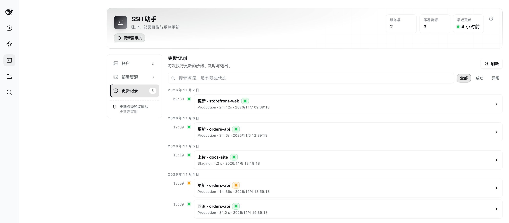
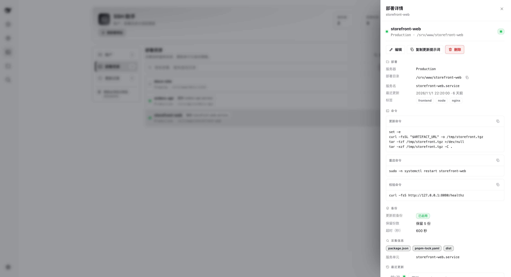

# DeepSeek Harness 的 SSH 助手

[](https://www.npmjs.com/package/@hunan36/dsh-ssh-helper)
[](https://www.npmjs.com/package/@hunan36/dsh-ssh-helper)
[](LICENSE)
[]()
[](https://github.com/hunan36/dsh-ssh-helper)

为 DeepSeek Harness 提供 SSH 账户管理、部署目录采集，以及**经人工审批**的远程更新与回滚。

`@hunan36/dsh-ssh-helper` 交给智能体的是一组很小、很克制、可审计的 SSH 能力：列出账户、只读地勘察服务器、以及——只在你点击批准之后——推送文件、执行更新或恢复备份。包内**没有**通用远程执行工具，面板里也**没有**"立即更新"按钮。每一次写操作，每一次都要经过 DSH 原生审批提示。



*部署资源视图：每个资源都带着服务器、应用目录、更新命令、重启/校验命令与备份策略。*

<p align="center">
  
  
</p>

<p align="center">
  
</p>

<p align="center">
  <em>依次为：账户视图、更新记录时间线、资源详情侧滑面板。面板只做展示与复制，从不执行任何远端写操作。</em>
</p>

---

## 为什么需要这个插件

一个能 SSH 进生产的智能体很有用——直到它在无人看管时执行了错误的命令。多数 SSH 插件要么完全不允许写，要么想写就写。本插件走中间路线：智能体可以自行发现并登记部署目录，可以自行准备完整的更新计划，但只要有一个字节要写到远端主机，DSH 就会停下来问你——审批提示里带着确切的目标、确切的命令和确切的备份路径。

审批不是"请模型自觉遵守"的约定，而是宿主进程里的一个 `tools/pre-execute` 处理器；工具实现无法绕过它，因为工具本体根本收不到"已批准"这样的标记。

## 功能

| 能力 | 说明 |
| --- | --- |
| 账户管理 | 新增、编辑、删除、逐台测试 SSH 账户。支持密码认证，或私钥（含可选 passphrase）。 |
| 连接测试 | 面板内可单台测试或全部测试；也可用 `ssh_helper_accounts` 的 `action="test"`（执行 `uname -srm` 与 `id -un`）。 |
| 旧数据导入 | 一键从已安装的 `@local/dsh-ssh-manager` 导入账户，按 `host:port:username` 去重。 |
| 只读目录采集 | `ssh_helper_discover` 在常见根目录（`/opt`、`/srv`、`/var/www`、`/data`、`/app`、`/home`）扫描项目标记，再勘察单个目录的顶层条目、标记文件、git 状态与监听服务。**从不读取文件内容**。 |
| 部署资源目录 | 每个部署资源保存服务器、应用目录、更新/重启/校验命令、备份策略、超时时间与采集到的事实。不含任何凭据。 |
| 更新计划 | `ssh_helper_update_plan` 执行只读预检（目录是否存在、是否可写、备份所需空间、标记、git 状态），返回计划 id、警告与阻塞项。不修改任何远端内容。 |
| 受控执行 | `ssh_helper_update_apply` 先备份，再依次执行更新 → 重启 → 校验，清理旧备份并记录历史。每次都要先问。 |
| 受控回滚 | `ssh_helper_update_rollback` 把当前目录移到一旁，解压记录中的备份，再可选地重启与校验。每次都要先问。 |
| 受控上传 | `ssh_helper_upload` 通过 SFTP 推送单个本地文件，随后**在服务器上**校验字节数与 SHA-256。校验不通过记为 `partial`，不会记为 `success`。 |
| 更新历史 | 每次 apply / rollback / upload 都记录步骤、退出码、耗时与输出尾部（最多 200 条）。 |
| 系统提示 | 每轮都重建一段 `## SSH Helper`，列出当前账户与资源，并明确告知三个写操作工具始终需要审批。 |
| 双语面板 | 左侧边栏面板，中英文案；账户 / 部署资源 / 更新记录三个视图，支持搜索、状态筛选与"复制提示词到会话"。 |

## 安装

**环境要求**

- DSH 需提供 `tools`、`systemPrompt`、`webServer`、`connection` 四个服务。已在 DSH `0.2.2-rc.1` 上验证；任何提供这四个宿主服务的版本都应可用。
- Node `^22.19.0 || >=24.0.0`。唯一运行时依赖是 `ssh2`，且不需要编译器：其原生加速件 `cpu-features` 是可选依赖，编译失败也能正常安装。

### 从 npm 安装（推荐）

把包安装到你的 DSH profile，并加入该 profile 的 bundle 列表：

```bash
# 在 DSH profile 目录内执行
pnpm add @hunan36/dsh-ssh-helper
```

然后把 `@hunan36/dsh-ssh-helper` 加入该 profile 的 bundle 列表。包内自带 bundle patch（`cordis.patch.yml`），把宿主侧挂载为加载器行 `ssh-helper`：

```yaml
- insert:
    - id: ssh-helper
      name: dsh-ssh-helper
      config: {}
```

### 从插件管理器安装（图形界面）

侧边栏 → 插件 → 添加插件，填入 npm 包名 `@hunan36/dsh-ssh-helper`；若是本地源码，则填入本目录的绝对路径。

### 从源码安装

```bash
git clone https://github.com/hunan36/dsh-ssh-helper.git
cd dsh-ssh-helper
npm install --ignore-scripts
npm test
```

然后让插件管理器指向该源码目录。

### 安装之后

- 宿主侧变更（工具、API、系统提示段、审批门）需要**重启 DSH**。
- 客户端变更需要**刷新页面**。
- 左侧边栏会出现 **SSH 助手** 入口，它**不在** DSH 设置里。

## 快速开始

五分钟，从零到一次受控更新。

1. **添加服务器。** 侧边栏 → SSH 助手 → 账户 → 添加服务器。填写主机、端口、用户名，以及密码或私钥（含 passphrase）。保存后点 **测试**——成功会显示远端的 `uname` 与用户。

2. **让智能体自己去看一眼。** 新开会话，说：

   > 在 10.0.1.24 上扫描部署目录，找到 web-api，把它的目录、git 信息和服务单元保存成部署资源。

   智能体会依次调用 `ssh_helper_discover`（`action="scan"`）、对候选目录再 `action="inspect"`，然后用 `ssh_helper_resources`（`action="save"`）落库。两个采集动作都是只读的。

3. **要一份计划。**

   > 给 web-api 生成一份更新计划，先别执行。

   智能体调用 `ssh_helper_update_plan`。你会拿到计划 id、解析后的应用目录、备份归档路径、更新/重启/校验命令、预检事实，以及警告与阻塞项。带阻塞项的计划无法执行。

4. **执行它。**

   > 批准，执行这个计划。

   智能体带着计划 id 调用 `ssh_helper_update_apply`。**DSH 会弹出审批提示**，列出资源、服务器、目录、备份路径和完整命令。你不批准，就什么都不会发生。

5. **看结果。** 这次执行会出现在"更新记录"里：每个步骤（预检、备份、更新、重启、校验、清理）各一行，带退出码、耗时与输出尾部。如果出了问题，说：

   > 把 web-api 回滚到上一次备份。

   这同样是需要审批的 `ssh_helper_update_rollback`。

### 可选：先上传构建产物

> 把 /Users/me/build/web-dist.tgz 传到 6.25 的 /tmp/web-dist.tgz，然后更新 web-fe。

智能体调用 `ssh_helper_upload`，你批准传输，文件经 SFTP 推送，插件在服务器上校验大小与 SHA-256 通过后才报成功。这个远端文件可以直接被更新命令消费，例如：

```bash
test -f /tmp/web-dist.tgz && tar -xzf /tmp/web-dist.tgz -C .
```

## 审批模型

在把插件指向真实服务器之前，这一节最值得读。

### 一个门，三个工具

插件只注册**一个** `tools/pre-execute` 处理器。它检查工具名，然后返回两种结果之一：

- `{ kind: 'ask', reason, displayReason: { en, zh } }`——写请求**可解析**时；
- `next()`——放行——其余一切情况。

随后 DSH 请求审批，并且**只在 `allowed-once` 决策下才真正派发工具执行**。拒绝、取消或审批通道不可用时，不会派发任何东西。工具本体完全不知道是否发生过审批；整个包里也不存在 `confirm`、`force` 或 `skip_approval` 之类的参数。

### 远端写操作成立，必须同时满足

1. 工具恰好是 `ssh_helper_upload`、`ssh_helper_update_apply` 或 `ssh_helper_update_rollback` 之一。
2. 参数能解析成一个具体目标：
   - **apply**——计划 id 存在、未过期、无阻塞项，且属于发起调用的那个智能体；
   - **rollback**——能为该资源解析到一条历史 `apply` 记录中的备份归档（可显式指定 `history_id`）；
   - **upload**——账户可解析，本地路径存在、非空、是普通文件且小于 2 GiB，远端路径通过路径校验。
3. 你在审批提示里对这一**次具体调用**给出允许一次（allow-once）。
4. apply 与 rollback 还要求该服务器上当前没有别的 apply/rollback 正在跑。

### 门挂不上时直接关闭写能力

如果门根本无法注册——宿主改名了 `tools/pre-execute`、插件加载顺序出错、任何抛出——宿主只记一条警告，并且**只注册只读工具**，`apply`、`rollback`、`upload` 三个写工具完全不挂载。原因在于 DSH 的 `tools/pre-execute` 瀑布默认结果是**放行**：一个没有门的写工具等于没有审批的写操作，所以门缺失时必须让工具消失，而不是留在那里无保护地跑。此时你会看到 4 个工具而不是 7 个，智能体也会被告知写工具不可用。

### 被批准的目标是"钉住"的，不会二次解析

回滚时，提示里写的是哪个归档，恢复的就是哪个归档。审批门会把解析到的备份记录钉住，工具本体消费这份钉住的目标，而不是再解析一次；如果期间资源的应用目录、服务器或历史记录发生了变化，钉住的目标立即失效。没有这一层，你打开审批框的这几秒里落一次 `apply`，就可能在你不知情的情况下换掉要恢复的目录树。apply 通过 `plan_id` 本来就有等价保证。

### 命令在提示里被围栏包起来

资源的更新命令是 shell 脚本，本来就可能有多行，所以不做压平处理，而是用 `----- command (verbatim) -----` 显式围起来。其余每个参与拼接的字段（资源名、服务器、目录、备份路径、重启/校验命令）都会被强制压成单行，并去掉控制字符与双向文本标记。因此资源名无法在你读的提示里伪造出一行 `Backup: disabled.`，路径也不会被反向渲染。

### 门放行（不弹审批）的情况

请求解析不出来时，**不会弹出审批提示，而是由工具本体返回一条指引信息**。这是刻意的：一个对应不到真实动作的审批框只是噪音，而一个无效请求也绝不能看起来像被批准过。放行的情况包括：

- apply 的计划 id 缺失、不存在、已过期，或属于别的智能体；
- apply 的计划带阻塞项（目录不存在、不可写、更新命令为空、备份目录位于应用目录内部、空间不足）；
- rollback 没有可用的备份记录；
- upload 账户不存在、本地路径非绝对路径或不可读、文件为空、文件超大，或指定了属于另一台服务器的资源。

### 审批预设

审批由 DSH 强制执行，因此会话的审批策略会生效。审批模式为 `never` 的预设会自动拒绝提示——更新不会执行，智能体收到拒绝。想让受控更新真正可用，请选择能够提问的预设。

### 提示里都有什么

| 工具 | 提示内容 |
| --- | --- |
| apply | 计划 id、资源名、服务器、应用目录、备份归档路径（或 `disabled`）、更新命令（超过 300 字符截断）、已设置的重启与校验命令、计划警告。 |
| rollback | 资源名、服务器、应用目录、要恢复的备份归档、一句"解压前会先把当前目录移到一旁"的说明、恢复命令、已设置的重启与校验命令、路径警告。 |
| upload | 文件名、人类可读大小、目标服务器、远端路径、本地路径、关联的部署资源（若提供）、一句"传输后会校验大小与 SHA-256"的说明、路径警告。 |

### 面板能做什么、不能做什么

面板是只读的诊断控制台。它调用插件自己的 HTTP API（`accounts/*`、`resources/*`、`history/*`），**没有更新或回滚按钮**。要改变远端主机的唯一途径，是被批准的智能体工具调用。

API 本身是 `POST /ssh-helper/api/<method>`，JSON 信封为 `{ ok: true, data }` 或 `{ ok: false, error: { code, message } }`。每个请求都经过 DSH 的 `connection.requestRejection` 校验，请求体上限 1 MiB，且没有任何方法会返回密码、私钥或 passphrase。

## 工具一览

共七个工具，统一 `ssh_helper_` 前缀。账户与资源都可用 id 或名称定位（先精确匹配名称、忽略大小写，再尝试唯一名称前缀）。

| 工具 | `action` / 关键参数 | 远端写入 | 审批 |
| --- | --- | --- | --- |
| `ssh_helper_accounts` | `action: list \| test`；`account`；`timeout_seconds`（1–120，默认 20） | 否 | 不需要 |
| `ssh_helper_discover` | `action: scan \| inspect`；`server`；`roots`；`path`；`max_depth`（1–4，默认 3）；`limit`（1–200，默认 80）；`timeout_seconds`（1–600，默认 60） | 否 | 不需要 |
| `ssh_helper_resources` | `action: list \| get \| history \| save \| delete`；`resource`；`server`；`name`；`app_dir`；`update_command`；`restart_command`；`verify_command`；`backup_enabled`；`backup_dir`；`backup_keep`（1–50，默认 5）；`timeout_seconds`（30–3600，默认 600）；`note`（≤500）；`tags`；`discovered` | 否（仅元数据） | 不需要 |
| `ssh_helper_update_plan` | `resource`；`timeout_seconds`（1–600，默认 60） | 否（只读预检） | 不需要 |
| `ssh_helper_update_apply` | `plan_id` | 是 | **每次必问** |
| `ssh_helper_update_rollback` | `resource`；`history_id`（可选） | 是 | **每次必问** |
| `ssh_helper_upload` | `server`；`local_path`；`remote_path`；`resource`（可选）；`timeout_seconds`（5–3600，默认 300） | 是 | **每次必问** |

插件刻意**不提供**通用远程执行工具。临时命令请继续用你已有的其他 SSH 插件；系统提示要求智能体：受管部署目录的变更必须走 `ssh_helper_update_*`，绝不通过通用 exec。

计划是一次性且短命的：15 分钟后过期，绑定创建它的智能体，并在 apply 尝试后即被丢弃，因此同一个 `plan_id` 无法重放。

## 安全模型

- **凭据只留在宿主侧。** `accounts.json` 仅由宿主进程读写。所有对外投影（工具结果、HTTP API 响应、系统提示、审批理由、更新历史）都剥离密码、私钥与 passphrase；API 也没有任何返回它们的端点。浏览器只在打开的表单里短暂持有敏感值，`localStorage` 只存一个无关标记（"已忽略旧数据导入"）。
- **文件权限。** 数据文件先写到同名 `.tmp` 再重命名到位，临时文件与最终文件都会尝试设置 `0600`（尽力而为——若文件系统拒绝 `chmod`，插件无法纠正）。解析失败的文件会被隔离为 `<name>.corrupt-<时间戳>`，插件从空存储启动而不是崩溃。
- **路径校验。** 每个远端目录都会被检查：必须是绝对路径、≤1024 字符、不含控制字符、不含 `..` 片段，且不能恰好是这些系统目录之一（`/`、`/bin`、`/boot`、`/dev`、`/etc`、`/lib`、`/lib64`、`/proc`、`/run`、`/sbin`、`/sys`、`/usr`、`/var`、`/var/lib`、`/var/log`、`/var/run`、`/home`），也不能位于 `/bin`、`/boot`、`/dev`、`/etc`、`/lib`、`/lib64`、`/proc`、`/run`、`/sbin`、`/sys`、`/usr` 之下的任何位置。备份目录适用同一套规则，且备份目录位于应用目录内部会被直接拒绝。
- **所有变量都加引号。** 任何进入远端 shell 的用户可控值都经过 POSIX 单引号转义（`'…'`，内部单引号转义为 `'\''`）。
- **先备份再变更。** 默认备份是应用目录的 `tar.gz`，写入 `<appDir 的父目录>/.ssh-helper-backups/<资源名>/<资源名>-<UTC 时间戳>.tar.gz`。若目标文件系统可用空间低于 `1.2 × 目录大小 + 10 MiB`，计划会带上阻塞项，无法执行。
- **不自动回滚。** 更新命令、重启或校验失败时，流程停止、保留备份并记录失败。不会在背后替你回滚，由你决定。
- **回滚本身可逆。** 解压归档前，当前目录会先被移动到 `<appDir>.ssh-helper-before-rollback-<UTC 时间戳>`，因此回滚前的状态得以保留。
- **主机密钥一律接受（v1）。** 客户端设置了 `hostVerifier: () => true`。目前既没有 `known_hosts` 固定，也没有 TOFU 提示；请据此评估到服务器的网络路径，优先使用 VPN 或堡垒机。
- **Shell 非交互。** 更新、重启、校验命令以 `cd <appDir> && bash -lc <命令>` 的形式在非 PTY 会话中、以 SSH 用户的权限执行。交互式 `sudo` 密码提示无人应答，请使用 `NOPASSWD` 的 sudoers 条目或 `sudo -n`。
- **命令是刻意可见的。** 更新、重启、校验命令会原样出现在审批提示和 `history.json` 中。不要把令牌、密码或密钥直接写进命令；改用文件或环境变量引用。捕获的**输出**是另一回事：stdout / stderr 尾巴在落盘前会做脱敏，遮蔽 `password` / `passwd` / `passphrase` / `token` / `secret` / `api_key` 赋值以及 PEM 私钥块。这层脱敏是纵深防御，不是"可以随便回显密钥"的许可——单独一行、没有 `name=value` 形状的密钥不会被它命中。
- **本地路径不回显。** 本地文件校验失败时返回的是不含路径的提示，智能体无法借上传报错去探测你机器上某个文件是否存在、有多大。路径仍然会出现在审批提示里，而那里的读者是你。
- **超时只作用于本地。** SSH 操作超时后插件会关闭本地连接，远端进程可能仍在继续运行。请为长时间构建或迁移预留足够的 `timeout_seconds`。
- **远端输出有上限。** 单条命令 stdout 上限 512 KiB、stderr 上限 256 KiB；历史中每条流只保留最后 8192 个字符。

## 数据与文件

数据目录解析顺序，先命中者优先：

1. `DSH_SSH_HELPER_DIR`——显式覆盖（测试、临时 profile）；
2. `$DSH_HOME/ssh-helper`；
3. `~/.dsh/ssh-helper`。

| 文件 | 内容 | 是否含凭据 |
| --- | --- | --- |
| `accounts.json` | SSH 账户：名称、主机、端口、用户名、认证方式、凭据、备注、时间戳 | **是**（权限 `0600`） |
| `resources.json` | 部署资源：服务器引用、应用目录、命令、备份策略、超时、标签、采集事实 | 否（权限 `0600`） |
| `history.json` | 最多 200 条 apply / rollback / upload 记录，含每步命令、退出码、耗时与输出尾部 | 否（权限 `0600`） |

旧数据导入依次读取 `$DSH_HOME/ssh-manager/servers.json` 与 `$DSH_PROFILE_DIR/data/ssh-manager/servers.json`。导入是手动的——插件从不自行导入——校验不通过或与已有 `host:port:username` 重复的条目会被跳过。

## 配置与限制

### 环境变量

| 变量 | 用途 |
| --- | --- |
| `DSH_SSH_HELPER_DIR` | 覆盖插件数据目录。 |
| `DSH_HOME` | 默认数据目录的基准路径，也是主要旧数据来源。 |
| `DSH_PROFILE_DIR` | 次要旧数据来源（`data/ssh-manager/servers.json`）。 |

### 远端主机要求

| 要求 | 用途 | 是否必需 |
| --- | --- | --- |
| POSIX `sh`、`tar`、`find`、`du`、`df`、`stat`、`id`、`uname` | 备份、预检、采集、上传校验 | 是 |
| SFTP 子系统 | 文件上传 | 仅 `ssh_helper_upload` |
| `bash` | 更新、重启、校验命令在 `bash -lc` 下执行 | 仅 apply/rollback |
| `sha256sum` 或 `shasum -a 256` | 上传摘要校验 | 仅上传 |
| `git` | 采集与预检时报告 remote/branch/commit/dirty | 可选 |
| `systemctl`、`docker`、`ss`/`netstat` | 采集时的原始服务与端口线索 | 可选 |

### 已知限制

- **仅支持单文件上传。** `ssh_helper_upload` 推送单个普通文件，不做目录同步、断点续传或远端删除，上限 2 GiB。
- **不做主机密钥固定。** v1 接受服务器出示的任何密钥（见上）。`known_hosts` 校验是目前最值得补上的控制项。
- **没有跨进程文件锁。** 写入在单个宿主进程内串行化，并按服务器做并发互斥，但两个共享同一数据目录的 DSH 进程之间，除了原子替换文件之外没有任何协调。
- **面板内没有更新按钮，这是设计如此。** 执行与回滚只能由智能体工具发起，以确保每次写操作都过审批门。
- **不自动导入旧账户。** 导入是一个按钮，不是后台迁移。
- **采集从不读取文件内容。** 只记录目录结构、标记文件名、git 元数据与服务名——绝不读取 `.env`、配置正文或日志。
- **备份是整目录归档。** 体积很大的 `node_modules` 或产物目录会显著放大归档体积与所需空间。
- **计划 15 分钟过期**，最多缓存 50 份；过期后必须重新生成。
- **输出会被截断。** stdout 超过 512 KiB 时该步骤只保留前段，尾部丢失；需要完整输出时请让命令本身安静一些。
- **尚未到 1.0。** 工具名、数据文件结构与面板布局仍可能在次版本之间调整。

## 与 `@local/dsh-ssh-manager` 的关系

两者共存。`dsh-ssh-manager` 继续提供它的 `ssh_servers` / `ssh_exec` 工具和设置页；本插件使用独立的 `ssh_helper_*` 工具命名空间与自己的侧边栏面板。交集仅限于按其 `servers.json` 账户列表做单向、按需导入——不会自动导入，导入之后也不再共享任何状态。

## 开发

```bash
npm test        # 语法检查 + node:test 单元测试与进程内 SSH 端到端测试
npm run smoke   # 宿主侧冒烟测试，不联网、不动真实数据目录
npm run check   # 仅语法检查
```

端到端用例会在回环地址上起一个真实的 `ssh2` 服务端（覆盖 probe、scan、inspect、plan、apply、rollback，以及一次"故意失败且必须保留备份、不得自动回滚"的更新）。

```text
dsh-ssh-helper/
├── index.js            # 宿主入口：store、service、审批门、工具、提示、API 都在一个 ctx.effect 内
├── client.js           # 侧边栏面板（单文件，仅依赖 React，无构建步骤）
├── cordis.patch.yml    # bundle 挂载行：ssh-helper
├── host/
│   ├── accounts.js     # 账户存储、0600、旧数据导入、敏感字段投影
│   ├── resources.js    # 部署资源目录
│   ├── history.js      # 有上限的更新历史
│   ├── atomic.js       # tmp+rename 的 JSON 存储，含损坏文件隔离
│   ├── ssh.js          # ssh2 exec / probe / SFTP 上传，有界捕获
│   ├── shell.js        # 路径校验、POSIX 引号、备份布局
│   ├── discover.js     # 只读 scan 与 inspect 命令构造
│   ├── update.js       # plan / apply / rollback 服务
│   ├── upload.js       # upload 的 resolve / execute 与服务端校验
│   ├── gate.js         # tools/pre-execute 审批处理器
│   ├── tools.js        # 七个智能体工具及其渲染器
│   ├── prompt.js       # ## SSH Helper 系统提示段
│   └── api.js          # /ssh-helper/api 前缀路由
├── locale/             # 插件管理器标题与描述（中、英）
├── test/               # 单元测试 + 进程内 ssh2 服务端 E2E
└── scripts/            # 语法检查、冒烟测试
```

## 参与贡献

欢迎在 [github.com/hunan36/dsh-ssh-helper](https://github.com/hunan36/dsh-ssh-helper) 提 issue 与 PR。请在开 PR 前跑一遍 `npm test`，并保持这一性质：没有任何工具能绕过 `host/gate.js` 写入远端主机——添加 `confirm`、`force` 或 `skip_approval` 逃生舱的 PR 会被拒绝。

## 许可证

[MIT](LICENSE)
